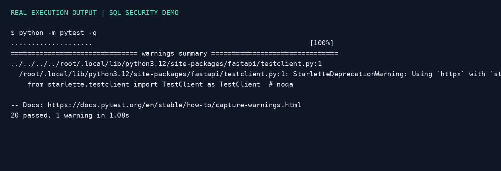
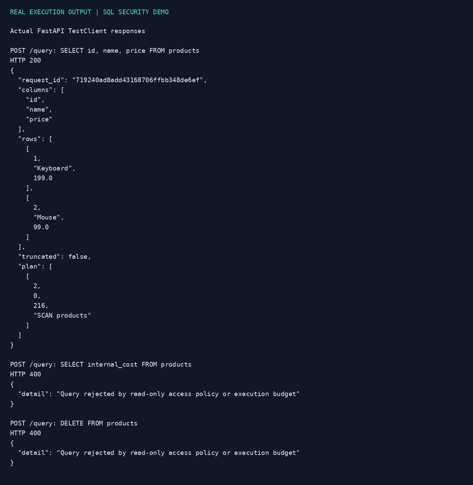

# SQL 查询安全控制 Demo

研发岗作业：针对数据库安全控制未接入执行流程的问题，使用 FastAPI + SQLite 实现一个可运行、可测试的独立示例。

> 未获得课程第 5 章原项目源码，本仓库是独立实现，不声称已修复原项目，也不声称完成限流、重试和熔断等全部要求。若要求基于课程原项目修改，需再集成到原仓库。

## 运行

要求 Python 3.11 或更新版本。

```bash
python -m venv .venv
source .venv/bin/activate
# Windows: .venv\Scripts\activate
python -m pip install -r requirements.txt
python seed.py
python -m uvicorn main:app --host 127.0.0.1 --port 8000 --log-level info --log-config logging.json
```

打开 http://127.0.0.1:8000/docs ，调用 POST /query：

```json
{"sql":"SELECT id, name, price FROM products ORDER BY id"}
```

非法示例：`SELECT internal_cost FROM products`、`SELECT * FROM secrets`、`DELETE FROM products`，返回 HTTP 400。

## 修复点

| 问题 | 实现 | 验证 |
|---|---|---|
| 安全策略没有进入请求流程 | /query 调用统一 query 函数 | API 测试 |
| 表/列访问未限制 | SQLite authorizer 仅允许 products 的 id/name/price | 敏感表、敏感列、CTE、UNION 测试 |
| 数据可能被修改 | mode=ro + 默认拒绝操作策略 | 增删改、DDL、多语句测试 |
| 未执行 EXPLAIN | 同一受限连接先运行 EXPLAIN QUERY PLAN，再执行查询 | 返回实际查询计划 |
| 查询资源无约束 | 4096 字符、100 行输出、约 100ms VM 进度预算 | 截断和递归超时测试 |
| 缺少可观测性 | 记录 request_id/status/duration_ms，不记录 SQL/数据 | logging.json 启用日志 |
| 缺少自动验证 | pytest + GitHub Actions | 20 个测试通过 |

EXPLAIN 用于准备检查和提供计划，未实现成本阈值或禁用全表扫描策略。时间预算是 SQLite VM 周期检查，不是严格墙钟超时。行数限制只限制返回量，不等价于扫描量限制。Demo 仅供本机模拟数据使用，未提供鉴权、多用户策略、多数据库路由或生产级资源隔离。

## 测试与效果图

```bash
python -m pytest -q
python evidence.py
```

实测：20 passed，1 条来自 Starlette TestClient 的弃用警告，不影响测试。效果图是脚本根据真实终端输出和 TestClient 返回值排版生成，非浏览器截图。




## Codex Review 操作

代码中已检查：默认拒绝策略、同一连接校验和执行、finally 关闭连接、异常不泄漏原始 SQL。没有调用远程 Codex Review 服务，不冒充其结果。

如课程要求 Review 截图：上传后创建 PR，在已启用 Codex Review 的仓库使用其审查功能，保存实际审查结果；若尚未启用则先完成配置。收到发现后修复并重新运行测试。
